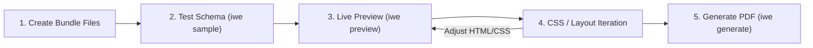

# iwe Template Creation Guide

Welcome to the definitive guide for designing, authoring, and testing custom template bundles for **`iwe`**.

`iwe` uses headless Chromium via Playwright to convert standard HTML, CSS, and Jinja2 markup into publication-quality PDF documents. This guide covers everything from directory structure and Pydantic schema validation to advanced print CSS, multi-page table handling, dynamic JavaScript charts, and copy-paste starter boilerplates.

---

## Table of Contents
1. [Anatomy of a Template Bundle](#1-anatomy-of-a-template-bundle)
2. [Step-by-Step Creation Walkthrough](#2-step-by-step-creation-walkthrough)
3. [Pydantic Schema Mastery](#3-pydantic-schema-mastery)
4. [Jinja2 Templating & Built-in Filters](#4-jinja2-templating--built-in-filters)
5. [Print CSS & Paged Media Architecture](#5-print-css--paged-media-architecture)
6. [Native Chromium Running Headers & Footers](#6-native-chromium-running-headers--footers)
7. [Client-Side JavaScript & Async Render Readiness](#7-client-side-javascript--async-render-readiness)
8. [Production Boilerplates](#8-production-boilerplates)
   - [Recipe 1: Commercial Tax Invoice](#recipe-1-commercial-tax-invoice)
   - [Recipe 2: Award Certificate (Landscape)](#recipe-2-award-certificate-landscape)
9. [Developer Iteration Workflow](#9-developer-iteration-workflow)
10. [Troubleshooting & Common Pitfalls](#10-troubleshooting--common-pitfalls)

---

## 1. Anatomy of a Template Bundle

In `iwe`, every document type lives in its own self-contained directory inside `templates/<bundle_name>/`:

```
templates/commercial-invoice/
├── template.html      # Visual markup, styling, and Jinja2 syntax
├── schema.py          # Pydantic Schema model validating the input payload
├── config.json        # Print parameters (paper format, margins, running headers/footers)
├── sample.json        # Realistic mock payload matching the schema
└── assets/            # Optional static assets (SVG logos, stylesheets, fonts, icons)
    ├── logo.svg
    └── styles.css
```

### Key Isolation Principles:
- **Zero Global Registration**: Bundles are discovered automatically by folder name. No central configuration edit is required.
- **Self-Contained Contracts**: Each bundle strictly owns and enforces its own schema.
- **Clean Source Guarantees**: `iwe` treats bundle directories as read-only. Previews and intermediate render artifacts are generated in isolated operating system temp directories.

---

## 2. Step-by-Step Creation Walkthrough

### Step 1: Create the Bundle Directory
```bash
mkdir -p templates/my-document/assets
```

### Step 2: Define the Schema (`schema.py`)
Create `templates/my-document/schema.py`. The file **must** declare a class named `Schema` that inherits from `pydantic.BaseModel`:

```python
from pydantic import BaseModel

class Schema(BaseModel):
    document_title: str
    recipient_name: str
    amount: float
```

### Step 3: Configure Print Settings (`config.json`)
Create `templates/my-document/config.json`:

```json
{
  "format": "A4",
  "landscape": false,
  "print_background": true,
  "margin": {
    "top": "15mm",
    "bottom": "15mm",
    "left": "15mm",
    "right": "15mm"
  }
}
```

### Step 4: Provide Sample Mock Data (`sample.json`)
Create `templates/my-document/sample.json` satisfying your schema:

```json
{
  "document_title": "Monthly Statement",
  "recipient_name": "Alex Mercer",
  "amount": 2500.00
}
```

### Step 5: Write the HTML Template (`template.html`)
Create `templates/my-document/template.html`:

```html
<!DOCTYPE html>
<html lang="en">
<head>
  <meta charset="utf-8">
  <title>{{ document_title }}</title>
  <style>
    body { font-family: sans-serif; padding: 10mm; color: #2d3748; }
    h1 { color: #2b6cb0; }
  </style>
</head>
<body>
  <h1>{{ document_title }}</h1>
  <p>Recipient: <strong>{{ recipient_name }}</strong></p>
  <p>Amount Due: <strong>{{ amount | currency }}</strong></p>
  <div id="render-ready"></div>
</body>
</html>
```

### Step 6: Verify and Render
```bash
# Verify discovery
iwe list

# Inspect sample data
iwe sample my-document

# Preview in browser
iwe preview my-document --data templates/my-document/sample.json

# Generate PDF document
iwe generate my-document --data templates/my-document/sample.json
```

---

## 3. Pydantic Schema Mastery

`iwe` validates the input payload before launching the Chromium browser. A strong schema prevents broken renders and gives immediate feedback to users and automated AI agents.

### Nested Collections and Models
```python
from typing import List, Optional
from pydantic import BaseModel, Field

class Item(BaseModel):
    description: str
    quantity: int = Field(ge=1, description="Quantity must be at least 1")
    unit_price: float = Field(ge=0.0)

class Customer(BaseModel):
    name: str
    email: str
    address: Optional[str] = None

class Schema(BaseModel):
    invoice_number: str
    date: str
    customer: Customer
    items: List[Item] = Field(default_factory=list)
    tax_rate: float = 0.08
    discount: float = 0.0
```

### Schema Aliases & Cross-Compatibility
If you want to support multiple payload naming conventions (e.g. `summary` and `executive_summary`), use `@model_validator`:

```python
from pydantic import BaseModel, model_validator

class Schema(BaseModel):
    title: str
    summary: str = ""
    executive_summary: str = ""

    @model_validator(mode="after")
    def sync_aliases(self) -> "Schema":
        if self.summary and not self.executive_summary:
            self.executive_summary = self.summary
        elif self.executive_summary and not self.summary:
            self.summary = self.executive_summary
        return self
```

---

## 4. Jinja2 Templating & Built-in Filters

`iwe` provides pre-registered Jinja2 filters for standard document formatting.

### Built-in Filters

| Filter | Usage | Input Example | Output |
| --- | --- | --- | --- |
| `currency` | `{{ value \| currency }}` | `1250.5` | `$1,250.50` |
| `currency(symbol, decimals)` | `{{ value \| currency("€", 2) }}` | `1250.5` | `€1,250.50` |
| `dateformat` | `{{ value \| dateformat }}` | `"2026-10-29"` | `October 29, 2026` |
| `dateformat(fmt)` | `{{ value \| dateformat("%Y/%m/%d") }}` | `"2026-10-29"` | `2026/10/29` |
| `number` | `{{ value \| number }}` | `14250` | `14,250` |
| `number(decimals)` | `{{ value \| number(2) }}` | `14250.789` | `14,250.79` |

### Injected Context Variables
`iwe` automatically injects helper variables into the template context:
- `_bundle_name`: Name of the current bundle (e.g., `"my-document"`).
- `_bundle_dir`: Absolute filesystem path to the bundle directory.

---

## 5. Print CSS & Paged Media Architecture

Chromium renders HTML using CSS Paged Media specifications. Designing for print requires a few key styling patterns:

### Physical Page Size and Orientation
Specify default paper dimensions via CSS `@page` or in `config.json`:
```css
@page {
  size: A4 portrait; /* or Letter, Legal, A4 landscape */
  margin: 15mm;
}
```

### Clean Page Breaks
To enforce a page break between sections (e.g. after a cover page):
```css
.page-break {
  page-break-after: always;
  break-after: page;
}

.page-break-before {
  page-break-before: always;
  break-before: page;
}
```

### Avoiding Awkward Splitting in Tables & Cards
Prevent elements like table rows, KPI metric cards, or signature blocks from being split across page boundaries:
```css
tr, .card, .signature-block, .metric-box {
  page-break-inside: avoid;
  break-inside: avoid;
}
```

### Repeating Multi-Page Table Headers
To repeat table column headers at the top of every subsequent printed page:
```css
thead {
  display: table-header-group;
}
tfoot {
  display: table-footer-group;
}
```

### Relative Asset Resolution
You can reference images and stylesheets using standard relative paths:
```html

<link rel="stylesheet" href="assets/styles.css">
```
`iwe` automatically injects a `<base href="file:///<bundle_dir>/">` tag during rendering so relative assets always resolve cleanly.

---

## 6. Native Chromium Running Headers & Footers

Chromium provides native support for repeating headers and footers outside the main document body using `header_template` and `footer_template` in `config.json`.

```json
{
  "format": "A4",
  "margin": {
    "top": "20mm",
    "bottom": "20mm",
    "left": "15mm",
    "right": "15mm"
  },
  "footer_template": "<div style=\"font-size: 8px; color: #718096; width: 100%; display: flex; justify-content: space-between; padding: 0 15mm;\"><span>Confidential Document</span><span>Page <span class=\"pageNumber\"></span> of <span class=\"totalPages\"></span></span></div>"
}
```

### Special Chromium Classes
Inside header/footer templates, Chromium populates special class placeholders:
- `<span class="pageNumber"></span>`: Current page number (1-indexed).
- `<span class="totalPages"></span>`: Total page count.
- `<span class="date"></span>`: Current system date.
- `<span class="title"></span>`: Document `<title>` tag value.

> [!IMPORTANT]
> **The Font-Size Rule**: Chromium defaults header/footer template text to `0px` font size! You **must** provide explicit inline CSS: `<div style="font-size: 9px; ...">`. Also ensure the document margins (`top` and `bottom`) are large enough (e.g., at least `15mm` to `20mm`) to give the header/footer room to render without overlapping body content.

---

## 7. Client-Side JavaScript & Async Render Readiness

`iwe` executes full JavaScript in headless Chromium. If your template loads web fonts, draws charts with Chart.js, generates dynamic barcodes, or runs animations, you must prevent Chromium from snapshotting the PDF prematurely.

### Dual Readiness Protocol
1. **Network Idle**: `iwe` automatically waits for all network requests to finish (`networkidle`).
2. **Dynamic Ready Signal**: You can signal when dynamic JavaScript has completed:
   - **DOM Element**: Include or dynamically insert `<div id="render-ready"></div>`.
   - **Window Flag**: Set `window.__RENDER_READY__ = true;` in your JavaScript.

### Example: Chart.js with Render Readiness Signal
```html
<canvas id="myChart" width="400" height="180"></canvas>
<script src="https://cdn.jsdelivr.net/npm/chart.js"></script>
<script>
  const ctx = document.getElementById('myChart').getContext('2d');
  new Chart(ctx, {
    type: 'bar',
    data: {
      labels: ['Q1', 'Q2', 'Q3', 'Q4'],
      datasets: [{ label: 'Revenue', data: [12, 19, 3, 5], backgroundColor: '#3182ce' }]
    },
    options: {
      animation: {
        onComplete: function() {
          // Notify iwe that rendering is completely finished
          window.__RENDER_READY__ = true;
          const signal = document.createElement('div');
          signal.id = 'render-ready';
          document.body.appendChild(signal);
        }
      }
    }
  });
</script>
```

---

## 8. Production Boilerplates

### Recipe 1: Commercial Tax Invoice

#### Directory Layout
```
templates/commercial-invoice/
├── config.json
├── sample.json
├── schema.py
└── template.html
```

#### `schema.py`
```python
from typing import List, Optional
from pydantic import BaseModel, Field

class LineItem(BaseModel):
    description: str
    quantity: int = Field(ge=1)
    unit_price: float = Field(ge=0.0)

class Schema(BaseModel):
    invoice_number: str
    issue_date: str
    due_date: str
    company_name: str
    company_address: str
    client_name: str
    client_address: str
    items: List[LineItem] = Field(default_factory=list)
    tax_rate: float = 0.08
    notes: Optional[str] = None
```

#### `config.json`
```json
{
  "format": "A4",
  "landscape": false,
  "print_background": true,
  "margin": {
    "top": "15mm",
    "bottom": "15mm",
    "left": "15mm",
    "right": "15mm"
  },
  "footer_template": "<div style=\"font-size: 8px; color: #a0aec0; width: 100%; display: flex; justify-content: space-between; padding: 0 15mm;\"><span>Commercial Invoice</span><span>Page <span class=\"pageNumber\"></span> of <span class=\"totalPages\"></span></span></div>"
}
```

#### `sample.json`
```json
{
  "invoice_number": "INV-2026-0891",
  "issue_date": "2026-10-29",
  "due_date": "2026-11-28",
  "company_name": "Apex Digital Labs Inc.",
  "company_address": "100 Innovation Way, Suite 400, San Francisco, CA 94107",
  "client_name": "Nordic Solutions Ltd.",
  "client_address": "45 Fjord Boulevard, Oslo, Norway",
  "items": [
    {
      "description": "Enterprise Cloud Architecture Consulting (40 hrs)",
      "quantity": 1,
      "unit_price": 6000.00
    },
    {
      "description": "High-Throughput PDF Generation Microservice",
      "quantity": 1,
      "unit_price": 4500.00
    },
    {
      "description": "Infrastructure Automated Setup & CI/CD",
      "quantity": 1,
      "unit_price": 2000.00
    }
  ],
  "tax_rate": 0.08,
  "notes": "Payment is due within 30 days via wire transfer."
}
```

#### `template.html`
```html
<!DOCTYPE html>
<html lang="en">
<head>
  <meta charset="utf-8">
  <title>Invoice {{ invoice_number }}</title>
  <style>
    * { box-sizing: border-box; margin: 0; padding: 0; }
    body { font-family: -apple-system, BlinkMacSystemFont, "Segoe UI", Roboto, sans-serif; color: #2d3748; padding: 10mm; font-size: 13px; line-height: 1.5; }
    .header { display: flex; justify-content: space-between; margin-bottom: 25px; border-bottom: 2px solid #edf2f7; padding-bottom: 15px; }
    .title { font-size: 24px; font-weight: 800; color: #2b6cb0; }
    .details { display: grid; grid-template-columns: 1fr 1fr; gap: 20px; margin-bottom: 25px; }
    .meta-box { background: #f7fafc; padding: 12px; border-radius: 6px; border: 1px solid #e2e8f0; }
    table { width: 100%; border-collapse: collapse; margin-bottom: 25px; }
    th { background: #ebf8ff; color: #2b6cb0; text-align: left; padding: 8px 12px; font-weight: 700; border-bottom: 2px solid #bee3f8; }
    td { padding: 8px 12px; border-bottom: 1px solid #e2e8f0; }
    .text-right { text-align: right; }
    .totals { width: 40%; margin-left: auto; margin-bottom: 25px; }
    .totals tr td { border: none; padding: 4px 0; }
    .total-row { font-size: 15px; font-weight: 800; color: #1a202c; border-top: 2px solid #2b6cb0 !important; }
  </style>
</head>
<body>
  <div class="header">
    <div>
      <div class="title">INVOICE</div>
      <div><strong>#{{ invoice_number }}</strong></div>
    </div>
    <div class="text-right">
      <strong>{{ company_name }}</strong>
      <div style="color: #718096; font-size: 11px;">{{ company_address }}</div>
    </div>
  </div>

  <div class="details">
    <div class="meta-box">
      <strong>Billed To:</strong><br>
      {{ client_name }}<br>
      <span style="color: #718096;">{{ client_address }}</span>
    </div>
    <div class="meta-box text-right">
      <strong>Issue Date:</strong> {{ issue_date | dateformat }}<br>
      <strong>Due Date:</strong> {{ due_date | dateformat }}
    </div>
  </div>

  <table>
    <thead>
      <tr>
        <th>Description</th>
        <th class="text-right">Qty</th>
        <th class="text-right">Unit Price</th>
        <th class="text-right">Amount</th>
      </tr>
    </thead>
    <tbody>
      
      
      
      
      <tr>
        <td>{{ item.description }}</td>
        <td class="text-right">{{ item.quantity }}</td>
        <td class="text-right">{{ item.unit_price | currency }}</td>
        <td class="text-right">{{ line_total | currency }}</td>
      </tr>
      
    </tbody>
  </table>

  
  

  <table class="totals">
    <tr>
      <td>Subtotal:</td>
      <td class="text-right">{{ subtotal.value | currency }}</td>
    </tr>
    <tr>
      <td>Tax ({{ (tax_rate * 100) | number }}%):</td>
      <td class="text-right">{{ tax_amount | currency }}</td>
    </tr>
    <tr class="total-row">
      <td><strong>Total Due:</strong></td>
      <td class="text-right"><strong>{{ grand_total | currency }}</strong></td>
    </tr>
  </table>

  
  <p style="color: #718096; font-size: 11px; margin-top: 15px;">{{ notes }}</p>
  

  <div id="render-ready"></div>
</body>
</html>
```

---

### Recipe 2: Award Certificate (Landscape)

#### `schema.py`
```python
from pydantic import BaseModel

class Schema(BaseModel):
    recipient_name: str
    achievement_title: str
    organization_name: str
    date_issued: str
    signatory_name: str
    signatory_title: str
```

#### `config.json`
```json
{
  "format": "A4",
  "landscape": true,
  "print_background": true,
  "margin": {
    "top": "0mm",
    "bottom": "0mm",
    "left": "0mm",
    "right": "0mm"
  }
}
```

#### `sample.json`
```json
{
  "recipient_name": "Eleanor Vance",
  "achievement_title": "Excellence in Systems Architecture & Scalability",
  "organization_name": "Global Engineering Institute",
  "date_issued": "October 2026",
  "signatory_name": "Dr. Marcus Thorne",
  "signatory_title": "Chairman of the Standards Committee"
}
```

#### `template.html`
```html
<!DOCTYPE html>
<html lang="en">
<head>
  <meta charset="utf-8">
  <title>Certificate of Achievement</title>
  <style>
    * { box-sizing: border-box; margin: 0; padding: 0; }
    @page { size: A4 landscape; margin: 0; }
    body { font-family: "Georgia", serif; background-color: #fafafa; display: flex; align-items: center; justify-content: center; height: 100vh; padding: 20mm; }
    .border-outer { border: 6px double #b7791f; padding: 15mm; background: #ffffff; width: 100%; height: 100%; display: flex; flex-direction: column; justify-content: space-between; text-align: center; box-shadow: 0 4px 12px rgba(0,0,0,0.05); }
    .header { font-size: 14px; text-transform: uppercase; letter-spacing: 3px; color: #b7791f; font-weight: bold; }
    .title { font-size: 32px; color: #1a202c; margin: 10px 0; font-weight: normal; }
    .subtitle { font-size: 14px; color: #718096; font-style: italic; }
    .recipient { font-size: 38px; color: #2b6cb0; font-weight: bold; margin: 20px 0; border-bottom: 2px solid #ecc94b; display: inline-block; padding: 0 30px; }
    .achievement { font-size: 16px; color: #4a5568; max-width: 600px; margin: 0 auto; line-height: 1.6; }
    .footer { display: flex; justify-content: space-between; align-items: flex-end; padding: 0 30mm; margin-top: 20px; }
    .sign-block { text-align: center; border-top: 1px solid #a0aec0; padding-top: 6px; width: 200px; font-size: 12px; }
  </style>
</head>
<body>
  <div class="border-outer">
    <div>
      <div class="header">{{ organization_name }}</div>
      <h1 class="title">Certificate of Recognition</h1>
      <p class="subtitle">This certificate is proudly awarded to</p>
    </div>

    <div>
      <div class="recipient">{{ recipient_name }}</div>
      <p class="achievement">For extraordinary contributions and demonstrated {{ achievement_title }}.</p>
    </div>

    <div class="footer">
      <div class="sign-block">
        <strong>{{ date_issued }}</strong><br>
        <span style="color: #718096;">Date of Conferral</span>
      </div>
      <div class="sign-block">
        <strong>{{ signatory_name }}</strong><br>
        <span style="color: #718096;">{{ signatory_title }}</span>
      </div>
    </div>
  </div>
  <div id="render-ready"></div>
</body>
</html>
```

---

## 9. Developer Iteration Workflow

When building a new template, use the CLI commands in this sequence:



1. **Verify Bundle Recognition**:
   ```bash
   iwe list
   ```
2. **Inspect & Validate Payload**:
   ```bash
   iwe sample <bundle_name>
   ```
3. **Live Interactive Preview**:
   ```bash
   iwe preview <bundle_name> --data templates/<bundle_name>/sample.json
   ```
   *(Opens the rendered HTML directly in your browser without creating a PDF file)*
4. **Generate the Final PDF Document**:
   ```bash
   iwe generate <bundle_name> --data templates/<bundle_name>/sample.json
   ```

---

## 10. Troubleshooting & Common Pitfalls

### Issue: Unwanted Blank Trailing Page
- **Cause**: An element's margin or padding pushes the page height just past the A4/Letter threshold.
- **Fix**: Check `body` margins in CSS and ensure your bottom-most element does not carry excessive `margin-bottom`. Remove `page-break-after: always;` on the final page of a document.

### Issue: Headers or Footers are Blank
- **Cause**: Chromium native headers and footers default to `font-size: 0px`!
- **Fix**: Ensure your `header_template` or `footer_template` string in `config.json` sets an explicit font size:
  ```json
  "footer_template": "<div style=\"font-size: 9px; ...\">...</div>"
  ```
- **Cause 2**: Page margins are too small to display the header/footer.
- **Fix**: Increase `margin.top` or `margin.bottom` in `config.json` (e.g. at least `15mm`).

### Issue: Web Fonts Fall Back to System Sans-Serif
- **Cause**: Chromium printed the PDF before the `@import` or `<link>` font stylesheet finished downloading.
- **Fix**: Add `<div id="render-ready"></div>` and use `document.fonts.ready`:
  ```javascript
  document.fonts.ready.then(() => {
    window.__RENDER_READY__ = true;
    const el = document.createElement('div');
    el.id = 'render-ready';
    document.body.appendChild(el);
  });
  ```

### Issue: Relative Images Fail to Load
- **Cause**: Referencing files from outside the bundle path.
- **Fix**: Place images inside `templates/<bundle_name>/assets/` and reference them as `assets/logo.png`. `iwe`'s `<base href>` injection will automatically locate them.
