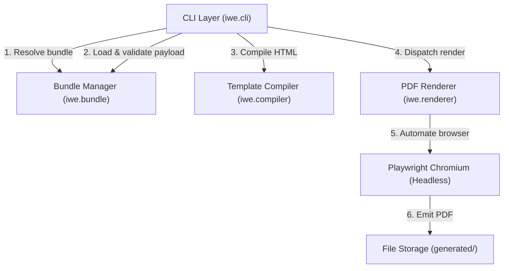
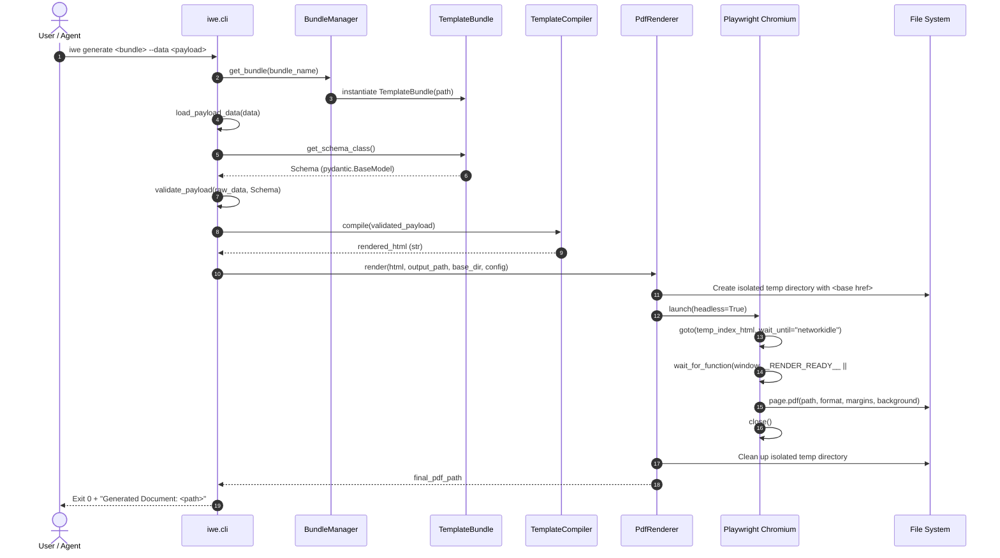

# iwe Architecture & Engine Internals

This document details the internal architecture, subsystem boundaries, data flow, and design patterns of the **`iwe`** PDF generation engine.

---

## 1. System Overview

`iwe` is structured as a decoupled, layered pipeline designed to transform external HTML/Jinja2 template bundles and structured data payloads into publication-grade PDF documents using headless Chromium.

### Component Diagram



---

## 2. End-to-End Request Lifecycle

When a caller executes `iwe generate <bundle_name> --data <payload>`, the following sequence is executed:



---

## 3. Subsystem Deep Dives

### 3.1 Bundle Management (`iwe.bundle`)
- **`TemplateBundle`**: Represents a colocated bundle folder under `templates/<bundle_name>/`. Exposes path properties for `template.html`, `schema.py`, `config.json`, `sample.json`, and static `assets/`.
- **Dynamic Schema Loading**: Loads `schema.py` dynamically via Python's `importlib.util.spec_from_file_location`, enforcing that the module declares a `Schema` subclass inheriting from `pydantic.BaseModel`.
- **`BundleManager`**: Scans the filesystem for installed template bundles and handles lookups, raising `BundleNotFoundError` if a requested bundle directory does not exist.

### 3.2 Template Compilation (`iwe.compiler`)
- **Payload Loading**: `load_payload_data` accepts either a local file path (`.json`) or an inline JSON string.
- **Validation**: Leverages Pydantic v2's `model_validate()` against the bundle's `Schema` to ensure strict contract enforcement before any browser process is launched.
- **Jinja2 Environment**: Initialized with a `FileSystemLoader` scoped strictly to the bundle's directory to allow sub-template inclusion (``) without path traversal risks.
- **Built-in Filters**:
  - `currency`: Formats numeric values with currency symbols and thousand separators (`$1,250.00`).
  - `dateformat`: Parses standard ISO dates and formats them into human-readable strings (`October 28, 2026`).
  - `number`: Formats large numbers with commas and optional decimal precision (`10,420`).

### 3.3 PDF Rendering (`iwe.renderer`)
- **Engine**: Headless Chromium orchestrated via Playwright Sync API (`sync_playwright`).
- **Relative Asset Resolution**: During rendering, `PdfRenderer` writes the compiled HTML into an isolated operating system temporary directory (`tempfile.mkdtemp`), automatically injecting a `<base href="file:///<bundle_path>/">` tag into `<head>`. This guarantees that relative links (``, `<link rel="stylesheet" href="style.css">`) resolve directly against the bundle without dirtying the source repository.
- **Dual Render Readiness Strategy** (per `ADR 0003`):
  1. Default wait: Waits for browser `networkidle` state.
  2. Dynamic signal: Evaluates in-page JavaScript for `window.__RENDER_READY__ === true` or the existence of a `#render-ready` DOM node (configurable via `ready_selector` and `ready_timeout_ms` in `config.json`).
- **Cleanup**: The temporary render folder is strictly pruned in a `finally` block via `shutil.rmtree`.

### 3.4 CLI & Machine Interface (`iwe.cli`)
- Built using **Typer** and **Rich**.
- **Commands**:
  - `iwe list`: Displays installed template bundles.
  - `iwe sample <bundle>`: Emits mock sample data formatted as JSON.
  - `iwe preview <bundle> --data <payload>`: Compiles the template with payload data, writes a preview file to the user's OS temp directory, and opens it directly in a visible browser.
  - `iwe generate <bundle> --data <payload>`: End-to-end PDF generation.
- **Agent/Machine JSON Mode**: Passing `--json` emits structured JSON responses (e.g. `{"status": "success", "document_path": "..."}`) or JSON error envelopes.
- **Exit Code Contract**:
  - `0`: Success.
  - `1`: User/Data error (missing bundle, invalid JSON, or Pydantic validation failure).
  - `2`: Playwright engine or rendering failure.

---

## 4. Exception Hierarchy

```
Exception
├── BundleNotFoundError (iwe.bundle) - Template bundle directory does not exist
├── SchemaLoadError (iwe.bundle)     - schema.py is missing, broken, or lacks 'Schema'
├── PdfRenderError (iwe.renderer)    - Playwright Chromium crashed or failed to print
├── pydantic.ValidationError         - Input payload violates bundle Schema
└── ValueError                       - Malformed JSON input string or missing file
```

---

## 5. Filesystem Isolation & Cleanliness

1. **Self-Contained Bundles**: Template bundles are treated as read-only assets at runtime.
2. **Preview Isolation**: `iwe preview` writes to the operating system temporary directory (`tempfile.gettempdir() / "iwe_previews"`), ensuring no scratch or preview artifacts pollute `templates/<bundle_name>/`.
3. **Render Isolation**: `iwe generate` renders HTML inside an ephemeral temp folder that is deleted immediately after `page.pdf()` completes.
4. **Output Destination**: Output PDFs are written to `generated/` by default (which is ignored by Git in `.gitignore`), or to the user-specified `--output` path.
